# Aiwa Store

<p align="center">
  <a href="https://github.com/theodoreyong9/Aiwa_store/actions/workflows/ci.yml"></a>
  <a href="https://github.com/theodoreyong9/Aiwa_store/actions/workflows/android.yml"></a>
  <a href="https://github.com/theodoreyong9/Aiwa_store/actions/workflows/pages.yml"></a>
  <a href="https://github.com/theodoreyong9/Aiwa_store/actions/workflows/registry.yml"></a>
  <a href="https://github.com/theodoreyong9/Aiwa_store/blob/main/LICENSE"></a>
  <a href="https://github.com/theodoreyong9/Aiwa_store/releases/tag/android-latest"></a>
  
</p>

# Ton univers. Ta volonté.

**Un système d'élevage d'agents personnels avec GitHub et Claude Code, sur Android.** Tu parles, même écran verrouillé ; des sessions Claude Code créent,
*dans ton propre dépôt*, des documents, vidéos, jeux, sites, applications Android et smart contracts. Aucun serveur à nous.

▶ Le film : [`docs/videos/aiwa-v30-16x9.mp4`](docs/videos/aiwa-v30-16x9.mp4) (fait avec les outils de ce dépôt).

> **Statut.** Testé en CI ; l'APK compile en CI. **Jamais essayé de bout en bout sur un vrai téléphone, sur le vrai Solana.**
> Voir [§12](#12-vérifié-et-non-vérifié).

## Sommaire

1. [Prérequis](#1-prérequis) · 2. [Installer](#2-installer) · 3. [Le widget](#3-le-widget) · 4. [Ce que Claude écrit, et où](#4-ce-que-claude-écrit-et-où)
5. [La voix](#5-la-voix) · 6. [Le super agent](#6-le-super-agent) · 7. [Boucles](#7-boucles-dagents) · 8. [Vidéos, cast, campagnes](#8-vidéos-cast-campagnes)
9. [Le cerveau](#9-le-cerveau-termux) · 10. [Store, registre, wallet, token, Yellow Paper](#10-store-registre-wallet-token-yellow-paper)
11. [Architecture](#11-architecture) · 12. [Vérifié et non vérifié](#12-vérifié-et-non-vérifié) · 13. [Développer](#13-développer) · 14. [Vision](#14-vision) · 15. [Licences](#15-licences)

---

## 1. Prérequis

- Un téléphone **Android**.
- **Termux** depuis **F-Droid** (ou ses releases GitHub) : le cerveau y tourne. Pas la version Play Store (copie ancienne, sans `RUN_COMMAND`).
- Un compte **Claude** (Claude Code dans le cloud) et un compte **GitHub** avec un dépôt. L'application GitHub *Claude* doit avoir accès à tes dépôts
  (`github.com/settings/installations` → **Claude** → *All repositories*).
- *Facultatif* : une **clé Anthropic** (§6), gardée dans Termux.

**Aiwa ne demande jamais de jeton GitHub** : il lit GitHub sans connexion (dépôts publics) ; ce sont les sessions Claude qui écrivent.

## 2. Installer

1. Télécharge `Aiwa_store.apk` sur la [release `android-latest`](https://github.com/theodoreyong9/Aiwa_store/releases/tag/android-latest) et installe-le
   (une nouvelle version s'installe par-dessus).
2. Dans Termux (aussi pour mettre à jour) :
   ```sh
   curl -fsSL https://raw.githubusercontent.com/theodoreyong9/Aiwa_store/main/android/backend/bootstrap.sh | bash
   ```
3. Ajoute le widget (l'appli le propose ; sinon appui long → *Widgets* → *Aiwa Store*). Autorise Termux et les notifications.
4. **Connecter Claude** (bouton du widget), puis choisis un **dépôt**. Dicte.

Si Termux ou le cerveau manque, le widget le dit et un appui copie la ligne. Claude Code s'installe dans une couche proot de Termux, marquée expérimentale.

## 3. Le widget

Un seul widget, en vues Android classiques : un appui sur un onglet ne fait que tourner une page (rapide). Une cellule de haut par défaut (fin), étirable en hauteur. En haut, quatre **onglets** ; la **question** de Claude (rouge, un appui y répond) et la **mise à jour** (↻, seulement quand une version est prête) restent toujours visibles. Un point sur un onglet dit ce qui travaille (une boucle, l'écoute) ; rouge quand quelque chose attend ta réponse.

- **Domaine** : Boucles · Wallet, puis Réglages · MCP (la porte des agents externes) · Cast TV (les télés trouvées, pour y envoyer une vidéo).
- **Files** : Docs · Média · App · Page · Contrat (gris tant que le dépôt n'a rien de ce type, coloré sinon ; un appui l'ouvre), puis Projet ▾ (dépôt et session, ou *Tous*) · Campagnes.
- **Build** : le super agent (orange, vert quand il écoute, rouge s'il a quelque chose à dire) et Claude ; l'écoute permanente, le « + » (pièces jointes) et Scénario.
- **Profil** (Réglages › Profil) : le dossier `Profile/` du dépôt que tu choisis, une production comme les autres. Tu dis au super agent qu'on travaille sur ton profil : c'est lui qui écrit `Profile/index.html` (vidéo ou GIF en fond, tes Files devant, tes contacts). Rien n'est publié : Aiwa lit le fichier tel quel dans le dépôt (public) et l'affiche. C'est ce que montre l'appli hors du widget, avec « Mettre le widget » en bas ; et dans Voir, un bouton **Profil** sur chaque personne (proches, favoris, lien) ouvre la liste en plein écran, on passe au suivant d'un glissement.
- **Accueil = profil** : la page du profil de la personne est aussi l'**accueil de l'application** (celle qu'on voit en ouvrant Aiwa hors du widget). Elle pose un bouton **Widget** (`data-aiwa-button="widget"`, qui ouvre le widget et ses quatre onglets par-dessus la page) ou des **emplacements** (`data-aiwa-slot="build"`, `"files"`, `"domain voir"`, `"all"`, ou `data-aiwa-button="docs"`) et l'application y met les vrais boutons du widget (`android/app/src/main/assets/home/aiwa-home.js`) : la personne règle disposition et style à la voix, en CSS, donc l'UX de son application. Elle **se recharge toute seule** : l'application suit le dernier commit du dossier `Profile/` (flux Atom de GitHub, ETag, toutes les 15 s) et relit la page À CETTE version. Sur le profil d'un **autre** (Voir › Profil), le design et tout ce qui est écrit dans la page sont à lui, mais les boutons des emplacements sont ceux du **visiteur** et agissent sur son compte ; la page de l'autre ne fait tourner aucun script (une politique mise en tête de la page, `HomeRuntime.lockScripts`). Sans profil, l'accueil par défaut (`assets/home/default.html`) montre tous les boutons ; sans emplacement, un bouton rond les ouvre tous. Elle montre **en haut ses scénarios** (`Profile/scenarios.json`, `<div data-aiwa-scenarios>`) : « Lancer chez moi » les enregistre chez le visiteur et les démarre, après une confirmation qui montre tout le texte quand ils viennent d'un autre. La page ne bloque jamais le défilement.
- **Papers** : dans les Réglages (section Papers), tous les liens de l'onglet Papers de l'application (le film, la source, le yellow paper, l'explication simple, la valeur, le carrousel, le plan, le business, la société augmentée), ouverts dans le navigateur.
- **Chambre** : dans le panneau du bouton Widget, l'onglet *Chambre*. Chacun appuie sur **Chambre** de son côté (le visité sur son accueil, le visiteur sur le profil de l'autre), puis l'un des deux appuie sur **Converser** : les super agents se découvrent et s'aident sans limite jusqu'à **Couper**, et **Écouter** les fait entendre. Un super agent en chambre ne parle à personne d'autre. **Danger**, activé des deux côtés, autorise messages et propositions entre eux ; sinon, seulement des paroles.
- **Voir** : un interrupteur *Visible / Caché* (coupé par défaut) à côté de **Proximité**, puis **Lien** (le nom GitHub et le dépôt suffisent : tu vois les liens de ses Files), **Proximité** (les profils détectés autour de toi, avec deux curseurs : la **portée**, de 50 m jusqu'au monde, et le **score minimum**, entre le plus bas et le plus haut détectés ; chaque profil a son bouton **Profil**), **QR code** (montre le tien, scanne un autre), **Favoris**. Rien n'est transféré : tu publies les **liens web des Files** de ton dépôt en cours (Docs, Média, App, Page, Contrat, seulement ceux qui existent, donc publics). Les personnes proches sont classées par **score Aiwa** (signé par la clé du portefeuille) ; la rencontre se fait dans un salon WebRTC par case de carte (38 × 19 m, puis des cases de plus en plus larges quand la portée grandit ; geohash : jamais ta position exacte), tant que la fenêtre est ouverte ; liens en https seulement, boutons *Bloquer* et *Garder en favori*.

Le **super agent** peut toucher à tous ces boutons avec `open` (comme un appui), sauf valider un paiement du Wallet ; il règle aussi les pastilles de session et de dépôt, envoie à la télévision et prépare un mail, un SMS, un rendez-vous, un appel ou un message (connecteurs : l'application s'ouvre pré-remplie, c'est toi qui envoies).

Les menus, listes et fenêtres (Projet, Réglages, Boucles, Campagne…) ont le même style : verre bleu-violet, cartes avec titre et sous-ligne, interrupteurs, flou de l'écran d'accueil derrière (Android 12 et plus).

**Réglages** (par sections) : *Voix et écoute* (conversation naturelle, **création à la volée**, écoute du réveil) · *Envoi* (modèle, effort, push) · *Agent et IA* (super agent, clé Anthropic, connecteurs) · *Contenus* (film de moi, banques de vidéos, agents externes) · *Parole et scénarios* (**scénarios**, **ma façon de parler**, *Mes mots*) · *Aiwa* (état, version de l'appli et du cerveau, « c'est prêt »).

**Scénarios** : un mot lance un double de toi (une session à lui, un super agent) qui écoute, note, parle quand tu le demandes et agit (`send`, `do`) ; « stop scénario » l'arrête. **Création à la volée** : sans clé, tout ce que tu dis part tout de suite au super agent, qui raconte l'avancement des trois sessions les plus récentes ; « mets-toi en pause » / « t'es toujours là » le coupent et le réveillent.

## 4. Ce que Claude écrit, et où

La même structure pour tous les dépôts :

| Production | Où | Détection (sans jeton) |
|---|---|---|
| Documents | `docs/` | fichiers `.md .pdf .docx .xlsx .pptx .txt .csv` |
| Vidéos | `docs/videos/` (étapes dans `docs/videos/<nom>/`) | fichiers vidéo (surveillé ~45 s) |
| Campagnes | `docs/campagnes/<campagne>/` | `campaign.json`, `proposals.json` |
| Page | GitHub Pages | `https://<compte>.github.io/<dépôt>/` répond 200 |
| App Android | release avec `.apk` | un `.apk` dans une release |
| Aiwa | `aiwa-apps/` | `*.aiwa.html` (contrats), `*.app.html` (bibliothèque) |
| Repli de signal | `aiwa-out/SIGNAL` (branche de la session) | lu si le relais est bloqué |
| Référence du critique | `aiwa-papers/` | relu à chaque tour |

**Les modes sont des instructions écrites** ajoutées au prochain message ; ils ne se disent pas.

- **App de bibliothèque** `aiwa-apps/nom.app.html` : un fichier HTML dans ton dépôt public, modifiable. Ni registre, ni wallet, ni score : le **brouillon / test**.
- **Contrat Aiwa** `nom.aiwa.html` : logique rejouable à partir d'événements signés, publié au registre, **immuable**, classé, avec brûlage de SOL.
  Claude écrit **d'abord le test** (`nom.aiwa.test.mjs`, lancé avec `node`), livre un **brouillon** dans ta bibliothèque et **ne publie rien** : tu publies
  avec ton wallet (**⇪** dans *Mes apps*).

## 5. La voix

Le micro du widget est le **mode agent**.

- **« instruction … »** règle **uniquement session et dépôt** ; le téléphone relit, tu valides par **« c'est bon vas-y »**.
- **Le reste** part tel quel à la session.

**Écoute permanente** : Vosk (local, ~41 Mo), même écran verrouillé, lancée par le bouton du super agent.

**Onze mots personnalisables** (*Réglages → Mes mots* ; à dire et/ou à écrire ; chaque changement est transmis au petit modèle, au parseur et au super agent) :

| # | Mot (défaut) | Effet |
|---|---|---|
| 1 | Réveil (« mon agent ») | tu dictes |
| 2 | Super agent (« mon super agent ») | l'ouvre |
| 3 | Instruction | règle session et dépôt |
| 4–5 | Pastille session · dépôt (« repo ») | « session … », « dépôt … » |
| 6 | Validation (« c'est bon vas-y ») | valide la relecture |
| 7 | Stop (« stop Claude ») | arrête, **toujours confirmé**, fait oublier le dernier commentaire |
| 8 | Éteins | coupe l'écoute et le super agent |
| 9 | Renvoi (« renvoie les instructions ») | renvoie instructions générales et pastilles |
| 10 | **T'es où là** | lit les pastilles du widget |
| 11 | **Fais ton rapport** | rapport du super agent + une idée |

« C'est prêt » annonce chaque production captée (réglable). Non essayé : « t'es où là » par le petit modèle, la voix de bout en bout.

## 6. Le super agent

Une session de supervision parlée, **intermédiaire** : il ne fait rien lui-même. Il propose, tu valides :

- `send` : un message à une ou plusieurs sessions ;
- `do` : session, dépôt, **ouvrir une production** (« montre-moi ma vidéo »), **cast** sur la TV.

Avec une **clé Anthropic**, il comprend le langage naturel et la clé remplace le parseur. **Détruire et recommencer** : *Réglages → Super agent* (la
conversation reste dans claude.ai à archiver). Ouvert, il grise le micro.

## 7. Boucles d'agents

Des échanges **entre sessions** : producteur, critique, soutien critique, tour à tour (nombre de tours limité), avec un **graphe pondéré** (*Boucles*).

- Le critique relit **`aiwa-papers/`** à chaque tour et reçoit les meilleurs **commentaires** du registre.
- **Liens entre critiques** : invitation, acceptation, registre des expéditeurs acceptés ; ce que dit l'autre est une **donnée**, jamais un ordre.
- Aiwa ne crée pas de session critique : crée-la dans claude.ai, ajoute-la par son lien.

*Testé contre de faux serveurs ; jamais entre de vraies sessions.*

## 8. Vidéos, cast, campagnes

- **Vidéos** : dernière production en tête (lecture, Cast, Download, Share), dossier `docs/videos/`, documents de `docs/` à cocher, qualité, formats. Liste lue
  par `git` (pas de limite d'API). Chaîne : `docs/PROMO-VIDEO.md`, [`video-kit`](video-kit), [`music-research`](music-research),
  [`asset-research`](asset-research), [`video-research`](video-research), [`design-research`](design-research) ; voix Piper (locale).
- **Cast TV** : DLNA / UPnP, depuis la fenêtre ou à la voix.
- **Campagnes** : un onglet par campagne, propositions par canal (WhatsApp, Telegram, mail, LinkedIn), aperçu avant partage, **une à la fois** ; Aiwa
  n'envoie rien, c'est ton application qui envoie.

## 9. Le cerveau (Termux)

Serveur Python local (`android/backend/aiwa_server.py`, `127.0.0.1:8787`) : relaie vers Claude Code, lit GitHub, garde sessions, boucles, agent, campagnes, vidéos.

- **Mise à jour** : `bootstrap.sh`, ou automatiquement (fast-forward de `main`, redémarrage) ; l'appli demande un redémarrage si le cerveau est plus ancien que
  `EXPECTED_BACKEND_VERSION`. L'APK : le widget cherche chaque minute (requête conditionnelle) ; ↻ vert ouvre l'installateur.
- **Sécurité** : écoute sur `127.0.0.1` seulement ; aucun jeton GitHub ; clé Anthropic locale ; relais ntfy.sh ou repli `aiwa-out/SIGNAL` ; ce que dit un autre
  critique est une donnée.

## 10. Store, registre, wallet, token, Yellow Paper

*Livré et testé en CI ; Solana et l'application GitHub y sont des doublures.* Tout est dans le dépôt : `packages/`, `registry/`, `apps/web/`, `store/`.

**L'idée.** Chaque téléphone garde son *propre* historique d'événements signés. Comme n'importe qui vérifie le travail d'un inconnu en millisecondes, un dépôt GitHub
peut être le registre et le classement, un paiement un fichier, et deux téléphones régler un jeu sans intermédiaire. Solana ne sert qu'**une fois** : le brûlage.

| | |
|---|---|
| **Store** | liste **classée** (contrats Aiwa, par ce que l'auteur a *miné*, vérifiés contre sa signature) et **Library** (apps des comptes GitHub suivis, sans classement). Boîte scellée, hors ligne |
| **Token AIWA** | créé par du **travail vérifiable** de ton téléphone, après **un** brûlage de SOL ; envoi par QR ou texte, même hors ligne |
| **Wallet** | 12 mots, carnet d'événements signés, sauvegarde, réseau (salle Trystero, réplicateur), *Relier un autre téléphone* (deux codes) |
| **Payer / jouer** | une app peut demander à payer (feuille de confirmation) ; [duel de clics](docs/demo-apps/click-duel.html) |

<!-- diagram: readme-01-c914959d.png -->
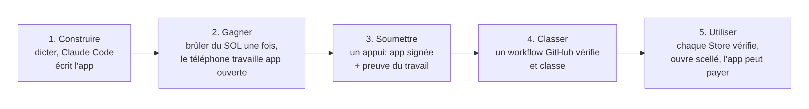

<details>
<summary>The source of this diagram (Mermaid)</summary>

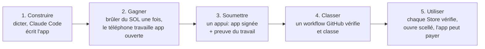

</details>
<!-- /diagram -->

1. **Construire** : une app dans ton GitHub, ou un contrat publié par Aiwa. 2. **Gagner** : brûlage de SOL ; **0,1 % de T** (la part mise de côté) au créateur,
montré avant de signer ; ensuite du travail signé, ce que tu réclames croît avec le temps. 3. **Soumettre** : pull request signée + preuve.
4. **Classer** : le workflow vérifie signature, preuve et brûlage **sur Solana**, classe par `score / laps`. 5. **Utiliser** : chaque Store vérifie avant d'ouvrir.

**Les trois piliers** (Yellow Paper II–III) : **Progression** (du temps sans horloge : du travail séquentiel vérifiable, §6) · **Conservation** (une créance ne
se déplace qu'une fois, §7) · **Mirror** (des reçus signés de ce qu'on a reçu, §8).

**Un contrat** = règles *état + événement → état*, rejouées par chaque détenteur. Trois règles : prouver qui agit **dans** l'action (`signedAction` /
`verifySignedAction`) ; gestionnaires **purs** ; un conflit a **un** vainqueur, le même pour tous. Exemple : [`docs/aiwa-app-example.html`](docs/aiwa-app-example.html),
guide : [`docs/CONTRACTS.md`](docs/CONTRACTS.md).

**Le registre** : une PR ajoute `submissions/<nom>.json` ; le workflow le lit comme une donnée, vérifie, écrit `store/`, ferme la PR avec le verdict. Trois sortes de
paquets : **code**, **contrat Aiwa** (pointeur signé vers un bundle épinglé par hash) et **commentaire** pour le critique (≤ 2000 caractères, classé comme
le code, jamais exécuté).

| Documents | |
|---|---|
| [`EXPLAINED`](docs/EXPLAINED.md) · [`EXPLICATION`](docs/EXPLICATION.md) | tout en mots simples |
| [`YELLOWPAPER`](docs/YELLOWPAPER.md) | protocole formel (7 parties, 4 annexes) |
| [`CONTRACTS`](docs/CONTRACTS.md) · [`BUSINESS`](docs/BUSINESS.md) · [`PLAN`](docs/PLAN.md) | écrire un contrat · modèle économique · périmètre v1 |
| [`ANDROID`](docs/ANDROID.md) · [`PROMO-VIDEO`](docs/PROMO-VIDEO.md) · [`VOICE-VIDEO-CAMPAIGNS`](docs/VOICE-VIDEO-CAMPAIGNS.md) | l'appli et le widget · la chaîne vidéo · voix et campagnes |

## 11. Architecture

**Vue d'ensemble.** Le téléphone ne produit rien : les sessions Claude Code écrivent dans ton dépôt.

<!-- diagram: readme-02-20977f57.png -->
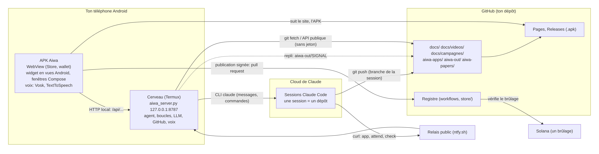

<details>
<summary>The source of this diagram (Mermaid)</summary>

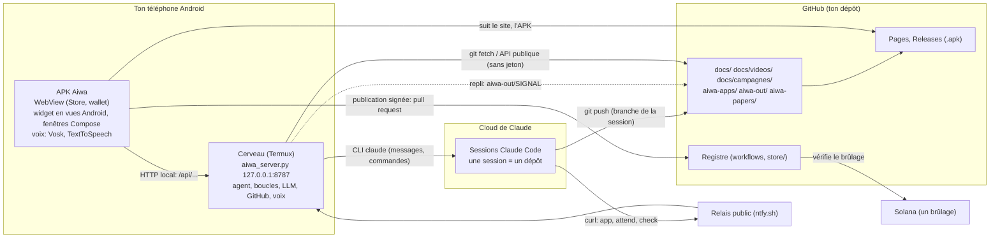

</details>
<!-- /diagram -->

| Frontière | Traverse | Ne traverse jamais |
|---|---|---|
| téléphone ⇄ cerveau | HTTP local (`127.0.0.1`) | rien d'exposé sur le réseau |
| cerveau ⇄ Claude / GitHub | messages, lectures publiques | jeton GitHub ; la clé Anthropic quitte Termux |
| appli ⇄ registre / Solana | publication **signée**, preuve de brûlage | les 12 mots |

**Du micro à la session.**

<!-- diagram: readme-03-46910341.png -->
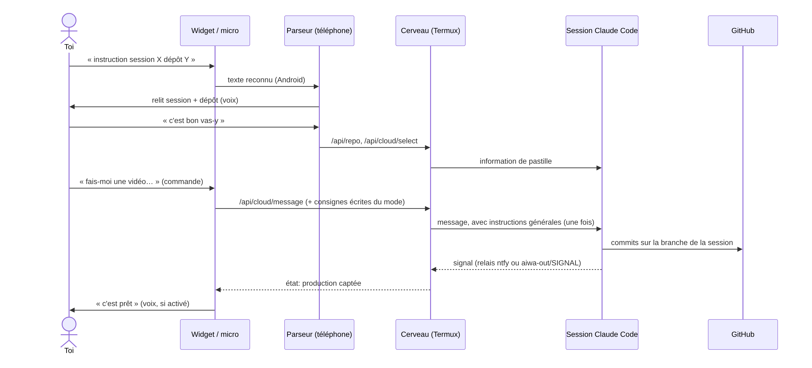

<details>
<summary>The source of this diagram (Mermaid)</summary>

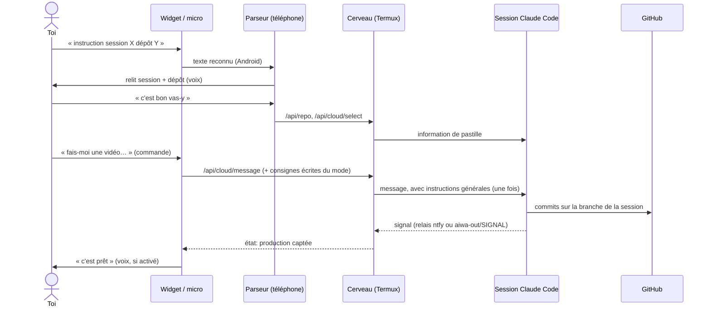

</details>
<!-- /diagram -->

**Les trois couches de l'appli** : `app` (Compose, Glance, services), `bridge` (Kotlin pur, testé en JVM : parseur, mots, pilules, API du cerveau), `backend` (Python).

<!-- diagram: readme-04-e48d4e51.png -->
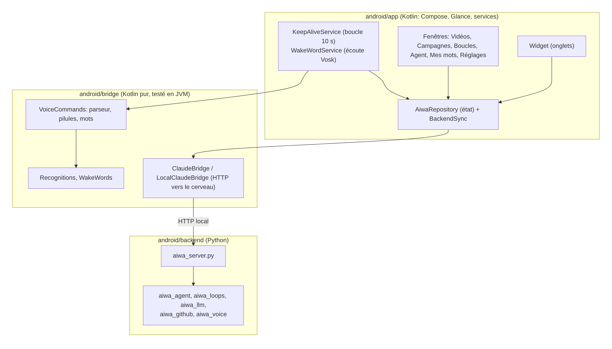

<details>
<summary>The source of this diagram (Mermaid)</summary>

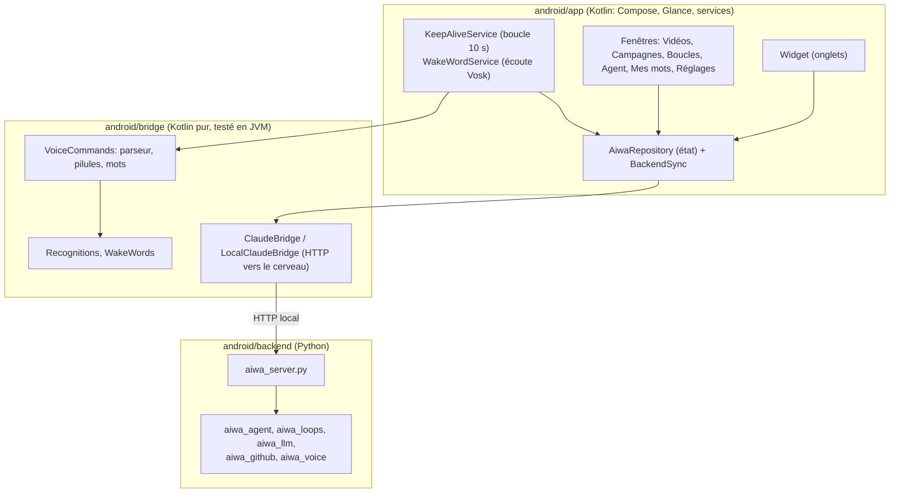

</details>
<!-- /diagram -->

**La voix.**

<!-- diagram: readme-05-03893869.png -->
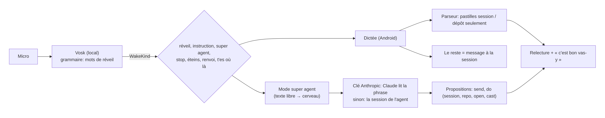

<details>
<summary>The source of this diagram (Mermaid)</summary>

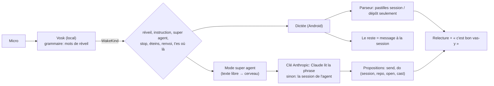

</details>
<!-- /diagram -->

**Boucles** : le cerveau est le **coursier** (une session reçoit mais n'envoie pas à une autre).

<!-- diagram: readme-06-225c1bd1.png -->
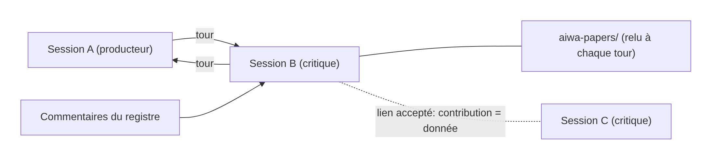

<details>
<summary>The source of this diagram (Mermaid)</summary>

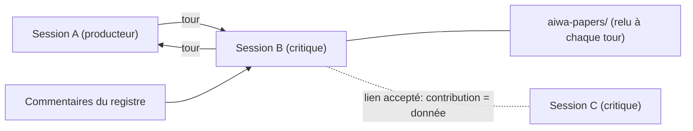

</details>
<!-- /diagram -->

**Protocole.** Une flèche = « utilise ».

<!-- diagram: readme-07-6c2a7637.png -->
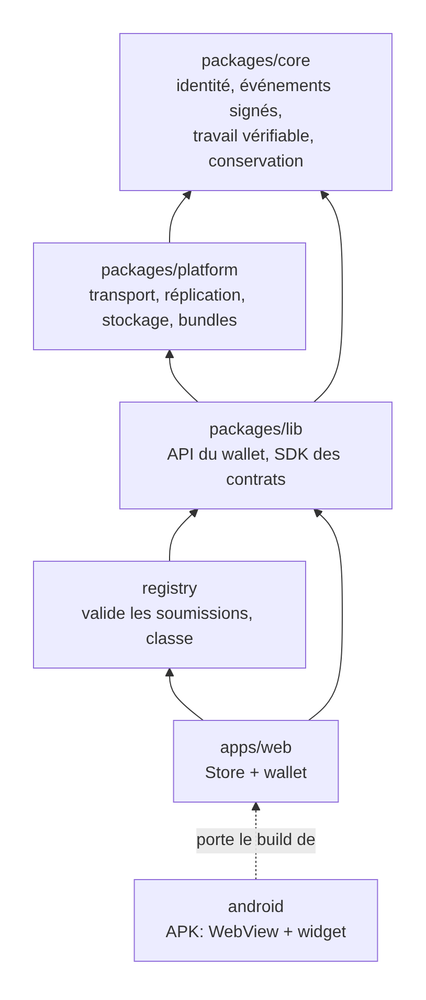

<details>
<summary>The source of this diagram (Mermaid)</summary>

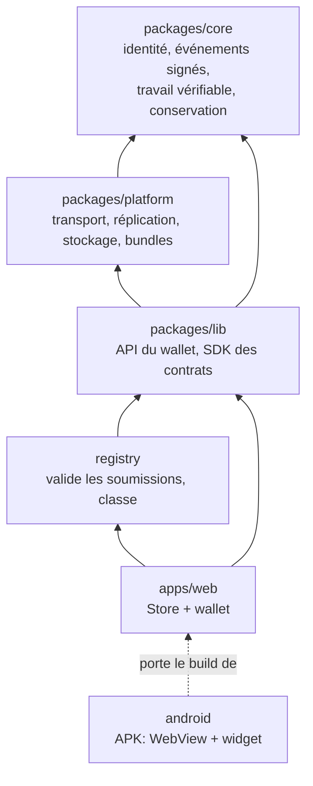

</details>
<!-- /diagram -->

**Publication.**

<!-- diagram: readme-08-f28dee12.png -->
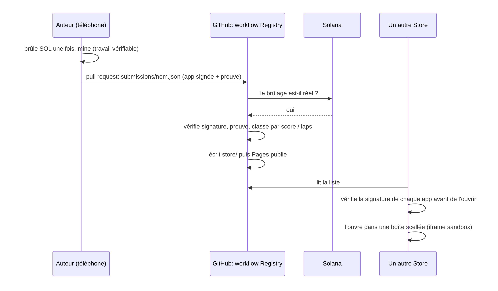

<details>
<summary>The source of this diagram (Mermaid)</summary>

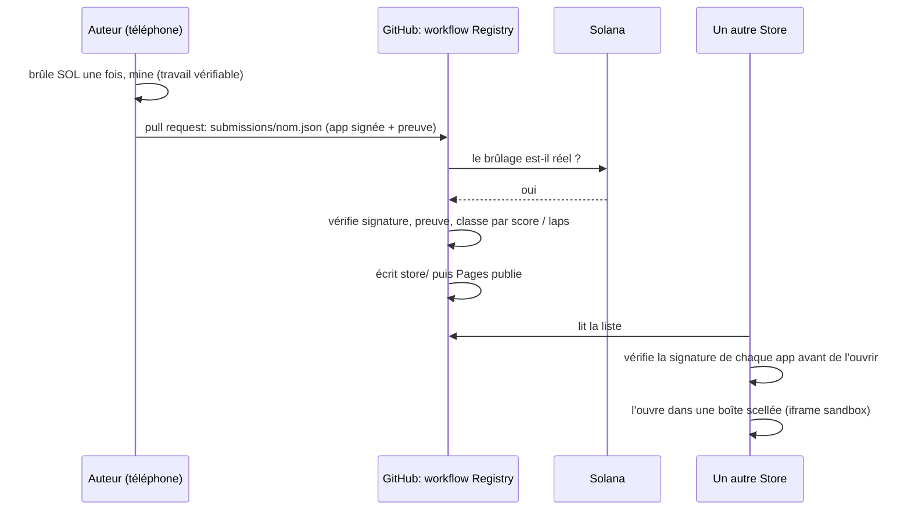

</details>
<!-- /diagram -->

**Livraison.**

<!-- diagram: readme-09-f7d4c994.png -->
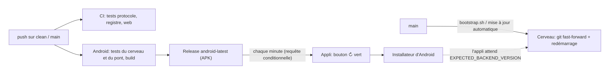

<details>
<summary>The source of this diagram (Mermaid)</summary>

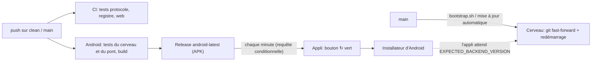

</details>
<!-- /diagram -->

| Donnée | Où |
|---|---|
| Productions | ton dépôt GitHub |
| Conversations | claude.ai |
| Sessions, dépôts, état, boucles, agent | `$HOME` de Termux (`.aiwa_*.json`) |
| Clé Anthropic | `~/.aiwa_anthropic_key` |
| Wallet (12 mots, carnet) | l'appli : **toi seul** |
| Liste classée | `store/` (Pages) · brûlages : Solana |

## 12. Vérifié et non vérifié

| Testé en CI | **Non vérifié** |
|---|---|
| Protocole, wallet, registre, appli web (Chromium) ; recoupement avec une implémentation Rust | Vrai brûlage sur Solana ; vraie pull request par le registre |
| Cerveau (relais, sessions, boucles, campagnes, agent, vidéos) contre de faux serveurs ; pont Kotlin | **Vrai téléphone** : keystore, connexion GitHub, widget, mise à jour par le site |
| Chaîne vidéo (rendu, contrôle, voix, musique) | Voix de bout en bout ; vraies sessions Claude Code pilotées par le cerveau |
| | Cast sur une vraie TV |

Aucune critique n'est indépendante tant qu'elle est faite par la chaîne qui produit.

## 13. Développer

```
packages/core | platform | lib   protocole · transport, stockage · API du wallet et SDK des contrats
registry/  apps/web/             registre · Store et wallet
android/app | bridge | backend   APK Kotlin · pont testé · cerveau Python
docs/  docs/videos/  docs/campagnes/    documents, films, campagnes
video-kit/ music- asset- video- design-research/    chaîne vidéo
aiwa-papers/  deployment.json  access.json    référence du critique · paramètres · liste d'accès (`enforce:false`)
```

```sh
npm install && npm test                                  # Chromium: npx -w aiwa-store-web playwright install chromium
python3 -m unittest discover -s android/backend/tests    # le cerveau
gradle -p android :bridge:testDebugUnitTest              # le pont Kotlin
gradle -p android :app:assembleDebug                     # l'APK (SDK Android ; la CI le fait)
node scripts/devnet-check.mjs --fake                     # tout le chemin contre un Solana de substitution
```

| Workflow | Fait quoi |
|---|---|
| **CI** | tests, diagrammes, contrôle à blanc du réseau réel |
| **Android** | tests cerveau et pont, build ; publie `android-latest` (depuis `main` et `clean`) |
| **Registry** | valide `submissions/*.json`, écrit `store/`, ferme la PR |
| **Pages** | publie le site |
| **Devnet check** | à la main ; rouge tant que `DEVNET_PHRASE` n'existe pas |

Règles : une ligne dans `CHANGELOG.md` par changement ; si le cerveau change côté appli, `BACKEND_VERSION` **et** `EXPECTED_BACKEND_VERSION` ; `main` seulement
CI et Android au vert. Au propriétaire : activer Pages (*GitHub Actions*), créer l'OAuth App *Aiwa Store* (Device Flow), `DEVNET_PHRASE`, le premier essai sur téléphone.

## 14. Vision

Intention, pas état : mise à jour du « corps » par **vote collectif** ; registre interplanétaire, store sans permission, économie gouvernée par le peuple avec
**brûlage de Solana** ; **Preuve de Volonté** (nom du film ; le Yellow Paper spécifie aujourd'hui la preuve de travail séquentiel, pas celle-ci) ; réseau de
**découverte, d'engagement et de création de proximité** ; code **100 % open en 2027**.

## 15. Licences

MIT ([`LICENSE`](LICENSE)). Film : « *Killers* », Kevin MacLeod (incompetech.com), CC BY 4.0 ; voix Piper ; polices Space Grotesk, Fraunces, JetBrains Mono (OFL).
Chaque catalogue de recherche indique source et licence.
